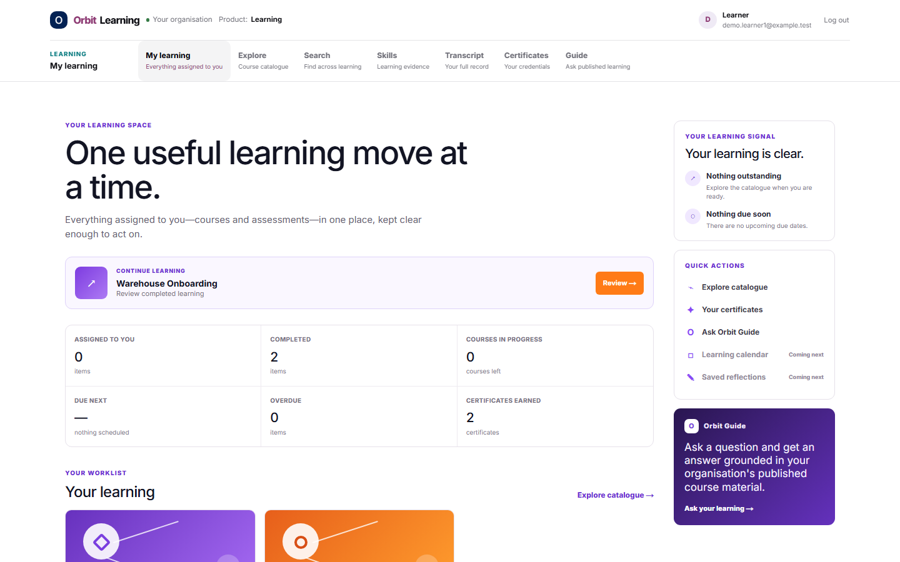
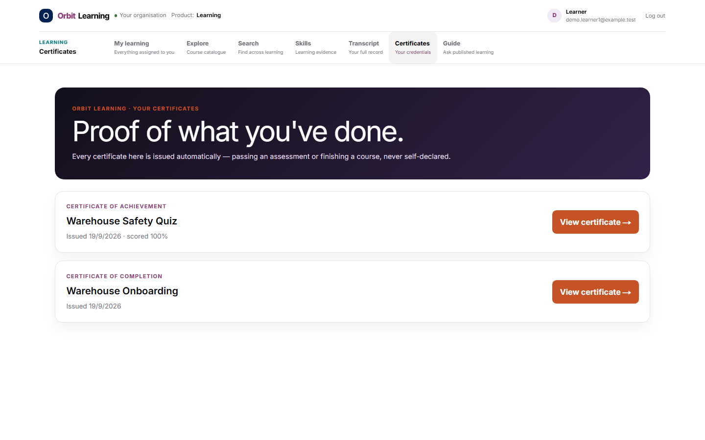
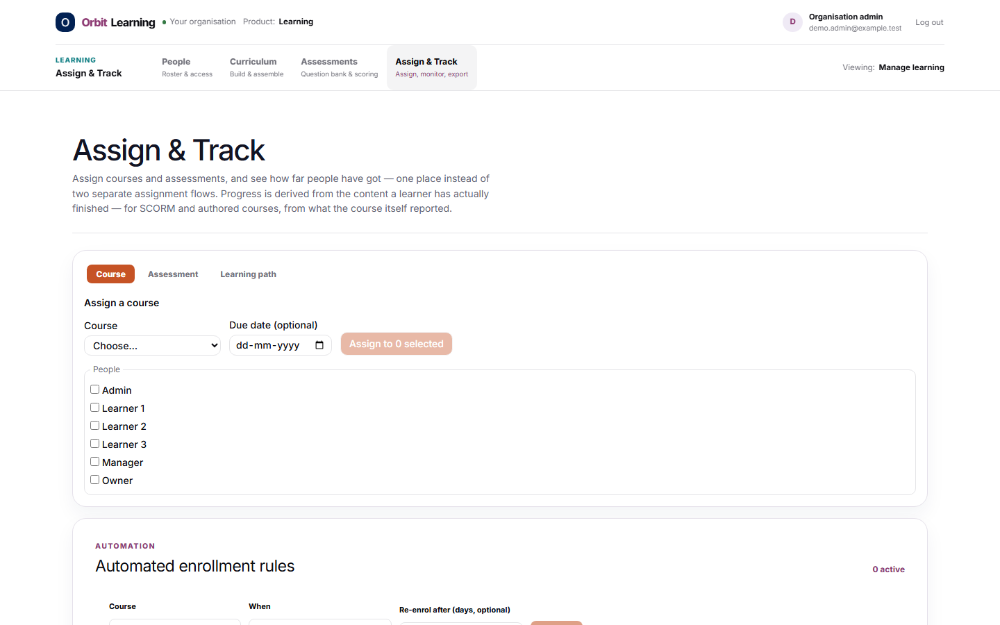

# Orbit Learning

**A free, open-source learning platform.** Build interactive courses, run SCORM / xAPI / cmi5 content, assess people, issue certificates, track skills — and collect 360° feedback — from one codebase you can host yourself.

It was built to prove that a full LMS does not have to be a per-seat subscription with a locked-in vendor. Use it, fork it, sell services around it, or learn from it. MIT licensed.

<p align="center">
  
</p>

## What you get

**Learning**
- Multi-tenant organisations with roles: learner, manager, organisation admin, organisation owner, plus platform owner/admin
- Course catalogue, course player, enrolment and assignment, due dates, enrolment rules
- Learning paths that auto-complete when their courses are done
- Learner dashboard, transcript, search, and an "Orbit Guide" assistant grounded in your published course material

**Authoring**
- Visual course editor with rich blocks, layers, timelines, triggers and variables
- Native runtime that plays what you author, with resume and xAPI statements
- Reusable components and templates; optional AI Course Builder (bring your own AI key)

**Standards**
- Import and play **SCORM 1.2** and **SCORM 2004** packages (isolated content origin for safety)
- Import **xAPI / Tin Can** content, with a built-in Learning Record Store
- Export authored courses as **SCORM 1.2, SCORM 2004, cmi5** or **xAPI** packages

**Assessment and credentials**
- Question bank: multiple choice, multiple response, true/false, fill-in-the-blank, sequencing
- Time limits, question pools, randomisation, attempt limits
- Certificates issued automatically on completion or a passing score, with a public verification page

**People and skills**
- Skill tags, learner skill evidence, and a competency development area with manager-level team signals (small groups are suppressed for privacy)
- Reports: completion, activity, learner detail, CSV export
- Append-only activity log

**Orbit 360 (360° feedback)**
- A separate feedback product in the same repo: static site in `public/orbit-360/`, serverless functions in `api/`, schema in `supabase/migrations/`
- Cycles, reviewers, confidential reports and action plans

**Engineering**
- Next.js 16 (App Router), React 19, TypeScript, Tailwind CSS 4
- Supabase (Postgres + Row Level Security + Auth + Storage)
- Vitest for unit and database tests, Playwright for end-to-end tests
- Tenant-isolation tests that check one organisation cannot read another's data

## Screenshots

<p align="center">
  
  
</p>

*Screenshots use the built-in demo data (`npm run seed:demo`).*

## Try it in 5 minutes

You need **Node 20+**, **Docker** (for the local database) and **git**.

```bash
git clone https://github.com/jaiminnair-hub/orbit-learning.git
cd orbit-learning
npm install

npx supabase start                 # starts a local Postgres + Auth + Storage in Docker
cp .env.example .env.local
```

Open `.env.local` and fill the first three values from the output of `npx supabase status`:

```
NEXT_PUBLIC_SUPABASE_URL=<API URL>
NEXT_PUBLIC_SUPABASE_PUBLISHABLE_KEY=<Publishable key>
SUPABASE_SECRET_KEY=<Secret key>
NEXT_PUBLIC_SITE_URL=http://localhost:3000
```

Then:

```bash
npm run dev                        # http://localhost:3000
npm run seed:demo                  # in a second terminal: creates a "Demo Org" with sample data
```

Log in at `http://localhost:3000/login` with password `Demo-data-123!`:

| Email | What you'll see |
| --- | --- |
| `demo.owner@example.test` | organisation owner and platform admin |
| `demo.admin@example.test` | organisation admin: authoring, people, reports |
| `demo.manager@example.test` | manager: team insights |
| `demo.learner1@example.test` | finished a course, passed a quiz, has certificates |
| `demo.learner2@example.test` | partway through a course, failed a quiz once |
| `demo.learner3@example.test` | brand-new account, nothing yet |

`npm run verify:demo` walks each of those accounts through the real UI and checks the screens.

> Local-only. The demo script refuses to run against anything but a local Supabase instance.

## Running it for real

1. Create your own **Supabase** project and apply the migrations: `npx supabase link --project-ref <ref>` then `npx supabase db push`.
2. Deploy the Next.js app (Vercel works out of the box; see [`docs/DEPLOYMENT.md`](docs/DEPLOYMENT.md)) and set the environment variables from [`.env.example`](.env.example).
3. Create your first administrator. Sign up in the app, then run this once in the Supabase SQL editor:

   ```sql
   -- make yourself a platform owner
   insert into platform_admins (user_id, role)
   select id, 'platform_owner' from auth.users where email = 'you@your-domain.com'
   on conflict (user_id) do update set role = 'platform_owner';
   ```

   Platform owners create organisations from **Platform Control** (`/platform`). To put yourself inside an organisation as its owner:

   ```sql
   update profiles
   set org_id = (select id from organizations where slug = 'your-org-slug'), role = 'org_owner'
   where email = 'you@your-domain.com';
   ```
4. Optional: set `RESEND_API_KEY` for email, an AI key (`AICREDITS_API_KEY` or `ANTHROPIC_API_KEY`) for the AI features, and Upstash Redis for rate limiting. Everything optional fails safe when unset.
5. **Orbit 360:** edit `public/orbit-360/orbit-platform-config.js` with your Supabase URL and *publishable* key (never a secret key), and set the server variables your `api/` functions need on your host.

## Testing

```bash
npm run typecheck
npm run lint
npm test            # unit + database tests (starts local Supabase)
npm run test:e2e    # ~85 browser tests; builds the app first, takes several minutes
```

## Repository map

| Path | What's in it |
| --- | --- |
| `app/` | Next.js routes: learner app, admin, platform console, API (`app/api/v1`) |
| `components/`, `lib/` | UI, authoring engine, runtime, SCORM/xAPI, assessments, auth, AI |
| `supabase/migrations/` | The whole database schema, RLS policies and functions |
| `apps/scorm-content/` | Separate credential-free origin that safely serves SCORM content |
| `public/orbit-360/`, `api/` | The 360° feedback product |
| `tests/` | Unit, database, tenant-isolation and end-to-end tests |
| `docs/` | Architecture, data model, security reviews, and historical build logs |

Some documents in `docs/` (for example `CURRENT_STATUS.md` and the `*_STATUS` / phase files) are the original maintainer's dated working logs. They are kept because they record *why* things are built the way they are, but they describe a specific historical deployment, not instructions for yours.

## Known issues

- **Autosave when leaving quickly.** In the built-in course player, if a learner advances a page and leaves within about 0.8 seconds, the new position may not be saved. The end-to-end test `tests/e2e/authored-course-runtime.spec.ts` ("a learner who leaves immediately after advancing does not lose their position…") fails intermittently because of it. The player already tries to flush on page-hide with `navigator.sendBeacon` (`components/runtime/RuntimeCoursePlayer.tsx`); the cause is not yet found. Help wanted.
- Some documents in `docs/` are dated working logs and may be out of date.

## Honest status

This platform was built and run in production by a solo maintainer, and the automated end-to-end suite passes (one autosave test currently fails intermittently, see Known issues). It has **not** been independently security-audited, and the email-sending, rate-limiting and AI integrations are optional and lightly exercised. Read [`SECURITY.md`](SECURITY.md) before you put real people's data in it. Issues and pull requests are welcome — see [`CONTRIBUTING.md`](CONTRIBUTING.md).

## License

[MIT](LICENSE) © 2026 Jaimin Nair. Free to use, modify and redistribute, including commercially.
