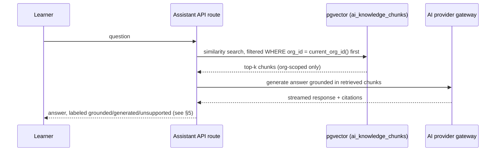

# AI Architecture

AI is a first-class MVP capability, not a single chatbot bolted onto a v1 launch. Four capabilities ship in v1; a fifth (AI Practice Lab) is explicitly P1/V1, deferred one increment per the revised priorities — not because it's unimportant, but because it depends on content that doesn't exist until Phase 2/3 are live.

## 1. Provider infrastructure (reused pattern from an earlier project, new code)

A single server-side gateway module fronts multiple LLM providers with automatic fallback (the shape of `lib/ai-provider.server.ts`, rebuilt fresh in the new repo — see the hard constraint in [ARCHITECTURE.md](ARCHITECTURE.md) §2). Two primitives every AI feature below calls through:

- `generateJSON(prompt, schema)` — structured output, used for course/question generation
- `streamChatResponse(messages)` — SSE streaming, used for the Learning Assistant

Every call, regardless of feature, writes one row to `ai_usage_log` (`org_id` from context, `user_id`, `feature`, `provider`, `model`, `tokens_in`, `tokens_out`, `latency_ms`, `success`, `error_message`, `cost_usd` where the provider reports it) — see [DATABASE.md](DATABASE.md) §6. This is non-negotiable per feature: no AI code path ships without a usage-log write on both the success and failure branch.

## 2. AI Learning Assistant (MVP)

Org/course-scoped retrieval-augmented chat.

Retrieval is always **filtered by tenant before** the similarity search runs (`WHERE org_id = current_org_id()` is part of the vector query itself, not a post-filter) — see [MULTI_TENANCY.md](MULTI_TENANCY.md) §5 and the AI Safety section below.

## 3. AI Course Builder v1 (MVP)

Administrator uploads a PDF / DOCX / PPT / plain text source. Multi-step generation pipeline, each step a separate `generateJSON()` call so failures are isolated and reviewable step-by-step rather than one giant opaque generation:

```mermaid
flowchart LR
    UP[Upload source doc] --> EX[Extract text\nsee CLOUDFLARE_VALIDATION.md]
    EX --> STRUCT[Generate course structure\nmodules + lessons]
    STRUCT --> OBJ[Generate learning objectives\nper module]
    OBJ --> SUM[Generate lesson summaries]
    SUM --> KC[Generate knowledge checks]
    KC --> Q[Generate assessment questions]
    Q --> DRAFT[Everything lands as status = draft]
    DRAFT --> REVIEW[Human review & edit\nrequired before publish]
```

**Every artifact this pipeline produces enters the content model at `status = draft`** (see [CONTENT_MODEL.md](CONTENT_MODEL.md) §6) — courses, modules, lessons, learning objectives, knowledge checks, and questions alike. Nothing generated is ever auto-published. The review UI (see [DESIGN_SYSTEM.md](DESIGN_SYSTEM.md), Administrator persona) presents the full generated draft for edit-in-place before an explicit "Approve & Publish" action, which is the only thing that moves status forward and triggers RAG re-embedding.

## 4. AI Question Generator (MVP)

Generates questions **only from approved, published content** — never from a draft, never from raw uploaded text directly (that's the Course Builder's job, and its output is still gated by the same draft/review/publish workflow). Supports `mcq`, `multi_response`, `true_false`, and `scenario` question types (matching `question_bank.type` in [DATABASE.md](DATABASE.md) §4). Retrieval for generation uses the same org-scoped RAG chunks as the Learning Assistant, so generated questions are traceable to a specific source passage — surfaced in the review UI so a human reviewer can verify the question against its source in one click. Human review and explicit publish is mandatory before any generated question enters a live assessment; generated questions default to `question_bank.status = draft`.

## 5. AI Safety

AI must never become an uncontrolled, unlabeled source of learning truth. Four concrete mechanisms:

1. **Grounded / generated / unsupported, always labeled.** Every Learning Assistant response carries a classification, computed from whether the answer was substantively derived from retrieved org content:
   - **Grounded** — the answer is built from retrieved, org-approved chunks; shown with source citations (links back to the originating Learning Object).
   - **Generated explanation** — the model elaborated beyond the retrieved chunks (e.g. rephrasing, worked examples) but the core claim traces to org content; shown with a lighter "AI-elaborated" indicator.
   - **Unsupported** — no relevant org content was retrieved at all; the UI must show this explicitly (e.g. "General knowledge — not verified against your organization's content") rather than silently answering as if it were authoritative. Whether an unsupported answer is shown at all vs. refused is an org-level setting for Phase 4, defaulting to "shown with a clear label" — never "hidden distinction."
2. **Tenant isolation is structural, not a filter.** As in [MULTI_TENANCY.md](MULTI_TENANCY.md) §5: the `org_id` predicate is part of the vector query itself. There is no code path where a cross-tenant chunk is fetched and then discarded — it is never fetched.
3. **Every vector/document record is tenant-scoped**, no exceptions: `ai_knowledge_chunks.org_id` is `NOT NULL` (see [DATABASE.md](DATABASE.md) §6) — the single most safety-critical constraint in the schema, called out explicitly so it's never "temporarily" nullable during development.
4. **Full usage logging**, per §1 above, on every call — tenant, user, feature, model/provider, tokens, latency, success/failure, cost. This is both a cost-control mechanism and a safety audit trail (e.g. investigating a specific bad answer starts from `ai_usage_log`, not from guessing).

## 6. AI Practice Lab — P1/V1, not MVP

Deferred per the revised priorities, but the technical basis is already identified: an earlier project's Sales/Underwriting Arena turn-based conversation + AI-scoring **mechanism** (persona → session → turn → scorecard) is industry-agnostic and reusable as a pattern (user-approved reuse case, see project memory `feedback-lms-scope-discipline`) — with all insurance personas and scenario content stripped, replaced by neutral scenario content once this ships. It is not built in Phase 4; it's noted here so the `learning_object.kind = 'scenario'` hook in [CONTENT_MODEL.md](CONTENT_MODEL.md) §3 is understood as the future integration point, not an unused column.
