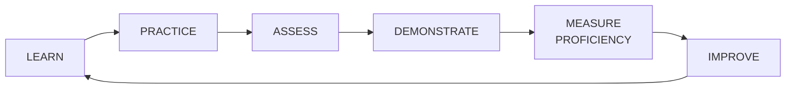
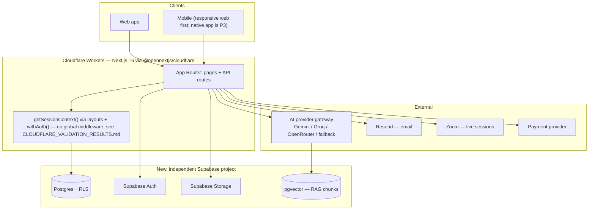

# Architecture

## 1. Product positioning

This platform is not scoped as an LMS clone. The LMS — content, courses, assessment, certification — is the **foundation layer** of a longer-term AI-native **Learning & Capability Platform**, structured around one cycle that every domain below ultimately serves:

- **LEARN / ASSESS are built in full for MVP** — content, courses, quizzes, certificates.
- **PRACTICE is scaffolded, not built** — AI Practice Lab is P1/V1, but the AI provider gateway and session/turn schema pattern are designed now so it slots in without rearchitecting.
- **DEMONSTRATE / MEASURE PROFICIENCY are data-model-ready, feature-deferred** — the Skills domain (P2) is not built, but every event that could one day feed a proficiency score (assessment results, practice sessions, assignment grades, course completions, manager evaluations) is already captured in a shape a future skills engine can consume without backfilling history. See [DATABASE.md](DATABASE.md) §7 and [MVP_SPEC.md](MVP_SPEC.md).

## 2. Hard constraint (repeated here because it governs every diagram below)

an earlier project (`the earlier project`) is live production software with paying subscribers. It is **read-only reference material only**. This platform is:

- A **new, independent Git repository** — never a fork, branch, or subfolder of an earlier project.
- A **new, independent Supabase project** — its own project ref, its own database, its own auth tenant. No shared tables, no cross-project foreign keys, no runtime call from the new platform into an earlier project's Supabase instance or vice versa.
- **Zero code changes to an earlier project.** Every "reuse" note in this package means *read an earlier project's code as a pattern, write new code here* — never edit-in-place.

## 3. System context

No component in `External` or `Data` is shared with an earlier project. AI provider accounts may reuse the same *vendor* (Gemini, Groq, etc.) an earlier project already uses, since those are third-party SaaS accounts, not an earlier project infrastructure — but API keys, usage, and logs are provisioned and tracked separately per [AI_ARCHITECTURE.md](AI_ARCHITECTURE.md) §5.

## 4. Layered domain architecture

Five layers, each depending only on the layer(s) below it. Security/tenancy is not a layer — it's enforced identically inside every layer (see [MULTI_TENANCY.md](MULTI_TENANCY.md)).

| Layer | Domains | Status for MVP |
|---|---|---|
| **1 — Platform Core** | Identity & Access, Multi-Tenancy, Organizations, Users, Roles & Permissions, Departments/Groups, Billing | **In progress.** Schema, RLS, and the data-layer tenant-isolation suite are done and verified (2026-08-14) — see [DEVELOPMENT_SEQUENCE.md](DEVELOPMENT_SEQUENCE.md) steps 1–6. Auth wiring, API-layer RBAC, and a minimal admin UI (steps 7–9) are next |
| **2 — Content & Learning** | Content Library, Content/Learning Objects, Courses, Modules, Lessons, Learning Paths, Programs, Enrollment, SCORM, basic ILT | Built in full — Phase 2 (see [CONTENT_MODEL.md](CONTENT_MODEL.md)) |
| **3 — Assessment & Certification** | Question Bank, Assessments, Attempts, Certificates | Built in full — Phase 3 |
| **4 — Intelligence** | AI Learning Assistant (RAG), AI Course Builder, AI Question Generator, AI usage logging; Skills data-model only | AI built in full — Phase 4. Skills: schema-ready, feature deferred (P2) |
| **5 — Growth & Operations** | Notifications, Audit, Analytics, basic gamification, AI Practice Lab | Notifications/Audit/basic analytics in MVP; AI Practice Lab and gamification are P1/P2 |
| **6 — People Intelligence Engine** *(future)* | Psychometric Assessments, 360° Feedback, Situational Judgement Testing, Behavioral/Cognitive Assessments | **FUTURE / ARCHITECTURE RESERVED — P2/P3.** Not built now; see [PEOPLE_INTELLIGENCE.md](PEOPLE_INTELLIGENCE.md) for the full domain design and the proof that it doesn't require redesigning Layers 1–5 |

Layer 6 is drawn as a layer, not a footnote, because it is the platform's eventual product ceiling — evolving the system from an LMS into a Learning & **Capability** Platform (§1) — but it sits **beside** Layers 2–3 (Content, Assessment), not on top of them: it defines its own entity families rather than extending the LMS content/assessment schema. See [PEOPLE_INTELLIGENCE.md](PEOPLE_INTELLIGENCE.md) §2 for why that separation is the load-bearing design decision.

## 5. What is explicitly deferred (see [MVP_SPEC.md](MVP_SPEC.md) and [FEATURE_MATRIX.md](FEATURE_MATRIX.md) for the full list)

HRIS/CRM integrations, the full skills/competency engine, social/collaborative learning, complex gamification, a native mobile app, a content marketplace, and the entire People Intelligence Engine (Layer 6) are all out of scope until the Layer 1–3 foundation is proven in production. AI Practice Lab is scoped as P1/V1, not MVP, per the revised AI priorities in [AI_ARCHITECTURE.md](AI_ARCHITECTURE.md).

## 6. Cloudflare validation status

The hosting layer in the diagram above (Cloudflare Workers via `@opennextjs/cloudflare`) was a recommendation, not a validated decision, as of the last revision of this document. **It was then spiked locally** — see [CLOUDFLARE_VALIDATION_RESULTS.md](CLOUDFLARE_VALIDATION_RESULTS.md) for the full item-by-item results, verdict at the time: proceed with Cloudflare. Document processing (the highest-risk item, load-bearing for AI Course Builder) passed cleanly; streaming, API routes, file upload, and SCORM-style content-type serving all passed. One real incompatibility was found and resolved architecturally, not worked around: Next.js 16's `proxy.ts` cannot run as Edge middleware and Cloudflare doesn't yet support Node.js middleware, so session/org-context resolution is centralized via route-group layouts + a shared API wrapper instead of a single global interceptor (reflected in the diagram above and in [API_SPEC.md](API_SPEC.md) §1) — that architectural choice is independent of hosting and stands regardless of what runs the deployment.

**Superseded 2026-08-21: the hosting target is now Vercel, not Cloudflare Workers.** `@opennextjs/cloudflare` and the Workers deploy tooling have been removed from the main app (`ORBIT_STATUS.md` §8, item 2). The Edge/`workerd`-shaped diagram above describes the validated-but-since-changed decision; it's kept for the architectural reasoning (the middleware finding above still holds) rather than as the current deploy target.
