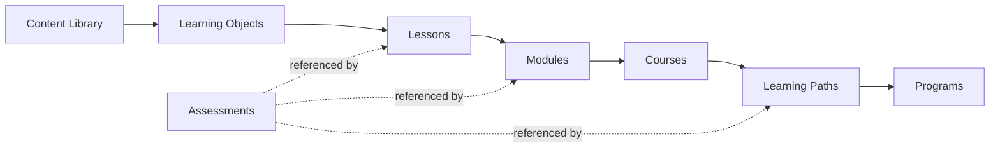
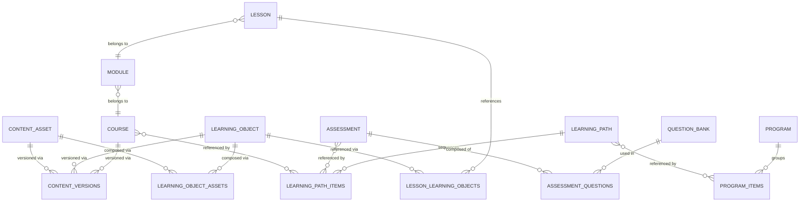

# Content / CMS Entity Model

This is the most important design decision in the platform — the CMS is what an earlier project never had (its ~12,600 lines of course/exam content are hardcoded TypeScript, not a database), and getting the reuse model right here determines whether every downstream domain (courses, paths, programs, AI generation, search) is built on solid ground or has to be reworked later.

## 1. The core idea

an earlier project models learning as `Course → Module → Lesson` — a single, rigid tree with no reuse. This platform separates **content** (the reusable material) from **structure** (how a specific course sequences that material), so the same piece of content can appear in multiple courses without being copy-pasted.

Everything left of **Courses** is reusable, tenant-owned material. Everything from **Courses** rightward is *structure/orchestration* — sequencing that material for a specific learning outcome. **Assessments** are a first-class entity that can be referenced at any structural level (a knowledge check inside a lesson, a module quiz, a gateway exam at the end of a learning path), not owned by any one of them.

## 2. Entity definitions

| Entity | What it is | Reusable? | Analogy |
|---|---|---|---|
| **Content asset** | The atomic uploaded/authored material — a video file, a PDF, a block of rich text, a SCORM package, a URL reference, an embed code. Has no pedagogical meaning by itself. | Yes — the base unit | A file on disk |
| **Learning object** | A pedagogically meaningful, reusable unit composed from one or more content assets, with a title, description, and (optionally) learning objectives. The smallest thing a learner experiences as "one piece of learning." | **Yes — this is the primary reuse unit** | A slide deck + its narration + a summary, bundled |
| **Lesson** | An ordered sequence of one or more Learning Objects within a Module — a single screen/page a learner moves through. Course-structural, not itself reused. | No (structural) | A page in a course |
| **Module** | An ordered group of Lessons within a Course, representing a thematic section. | No (structural) | A chapter |
| **Course** | An ordered collection of Modules; the primary unit of enrollment, progress, and completion tracking. | No (structural), but a whole Course can be referenced by multiple Learning Paths | A textbook |
| **Assessment** | A standalone, gradeable evaluation built from Question Bank items, with its own scoring/attempt/time-limit rules — independent of course structure. Can be embedded (knowledge check, module quiz) or standalone (certification exam). | Yes — one Assessment can be attached in multiple places | An exam |
| **Learning path** | A sequenced set of Courses and/or standalone Assessments, built toward a broader outcome. Orchestration only — carries no content of its own. | No (structural), but paths can share the same Courses | A curriculum |
| **Program** | The broadest grouping — one or more Learning Paths plus program-level scheduling, cohorts, instructor-led components, and program-level certification. | No (structural) | A semester |

## 3. Content types

Two different taxonomies get flattened together in casual conversation — this model keeps them distinct:

**A. `content_asset.type`** — what kind of *file or reference* this is:
`text` · `video` · `audio` · `pdf` · `ppt` · `document` · `url` · `embed` · `scorm`

**B. `learning_object.kind`** — what kind of *pedagogical wrapper* this is (a Learning Object always wraps zero-or-more content assets, but its *kind* determines how the player renders and scores it):
`content` (presents one or more assets — the common case) · `knowledge_check` (a short, low-stakes check embedded mid-lesson, backed by 1–3 Question Bank items) · `assignment` (learner submits a file/text response for manual or AI-assisted grading) · `scenario` (a branching or AI-driven situational exercise — the entry point for future AI Practice Lab content)

**C. The `Assessment` entity** is not a Learning Object kind — it's a sibling top-level entity, because assessments need attempt/scoring/time-limit rules that don't apply to a lightweight knowledge check. A knowledge check *can* internally reference a small Assessment when it needs graded attempts; most knowledge checks don't.

## 4. Reuse mechanics

- `learning_object_assets` (join: `learning_object_id`, `content_asset_id`, `sequence`) — a Learning Object composes 1..N Content Assets.
- `lesson_learning_objects` (join: `lesson_id`, `learning_object_id`, `sequence`) — **many-to-many, on purpose**. The same Learning Object (e.g. a standard "Code of Conduct" explainer) can be referenced by a Lesson in an Onboarding course *and* a Lesson in an Annual Refresher course, without duplication.
- Lessons, Modules, and Courses themselves are **not** many-to-many below the Learning Path level — they belong to exactly one parent. This keeps course authoring simple (a course owner isn't surprised by edits rippling in from an unrelated course) while still delivering the reuse the brief asked for, because the reuse lives one level down, at the Learning Object.
- **Reuse safety:** editing a shared Learning Object only affects courses that reference its *next published version* — see versioning below. A learner mid-course never sees content shift under them because someone edited a shared object elsewhere.

## 5. Versioning

Every versionable entity (`content_asset`, `learning_object`, `course`, `assessment`, `question_bank` item) carries:

- `status`: `draft → review → approval → published → archived` (exactly the workflow requested)
- `version` (integer, increments on every publish)
- A companion **`content_versions`** table (polymorphic: `entity_type`, `entity_id`, `version_number`, `snapshot jsonb`, `published_by`, `published_at`) — an immutable record of exactly what a course looked like at each publish event.

**Why this matters in practice:** a learner who is 60% through a Course sees the version that was published when they enrolled, not a version that changed underneath them because an author edited a shared Learning Object last week. New enrollments pick up the latest published version; in-progress enrollments can optionally be migrated by an admin action, never silently.

## 6. Workflow, ownership, metadata, tagging

- **Draft → Review → Approval → Published → Archived** is enforced as a state machine (valid transitions only; e.g. `published → draft` is not a direct transition — publishing a new version starts a fresh `draft` on top of the still-live `published` version). `content_reviews` (polymorphic: `content_type`, `content_id`, `reviewer_id`, `decision`, `comments`, `reviewed_at`) is the audit trail for every review/approval step.
- **Ownership:** every content entity carries `owner_id` (current responsible author, reassignable) and `created_by` (immutable). Collaborative/multi-author editing is explicitly P2 (see [MVP_SPEC.md](MVP_SPEC.md)) — the ownership field is designed now so it doesn't need retrofitting.
- **Metadata:** a `metadata jsonb` column on `content_asset`/`learning_object`/`course` holds extensible structured data (source, language, difficulty, estimated duration, learning objectives array) without schema churn every time a new metadata need appears.
- **Tagging:** a normalized `tags` table + polymorphic `taggables` join (`taggable_type`, `taggable_id`, `tag_id`) rather than array columns — this lets an admin rename or merge a tag platform-wide in one place, and keeps tag taxonomy manageable as the library grows.

## 7. Search and future AI retrieval

Two complementary indexes over the same content, not duplicate systems:

- **Keyword search (MVP):** a generated `tsvector` column on `content_asset`/`learning_object`/`course` (title + description + tags), backing the admin content-library search and learner course search.
- **Semantic retrieval (AI, MVP):** on every `status → published` transition, the published content is chunked and embedded into `ai_knowledge_chunks` (org-scoped, pgvector), described fully in [AI_ARCHITECTURE.md](AI_ARCHITECTURE.md). **Draft content is never embedded** — this is the mechanism that guarantees the AI Learning Assistant only ever answers from approved material, tying directly into the AI Safety requirements.

## 8. Entity relationship summary

Full column-level definitions for each of these tables are in [DATABASE.md](DATABASE.md) §3.
