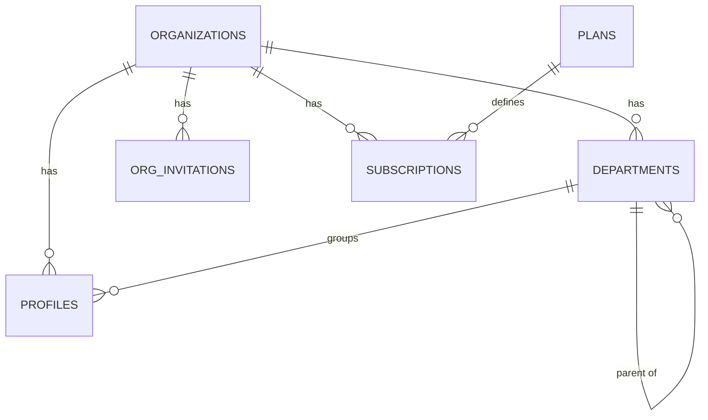

# Database Architecture (ERD)

Single Postgres database (new, independent Supabase project — see [ARCHITECTURE.md](ARCHITECTURE.md) §2), shared schema, row-level tenant isolation. This document defines every table needed for MVP ([MVP_SPEC.md](MVP_SPEC.md)), the standard column pattern applied to all of them, and the RLS strategy. Full policy SQL patterns live in [MULTI_TENANCY.md](MULTI_TENANCY.md); this document defines the schema those policies attach to.

## 1. Standard pattern applied to every tenant-owned table

Unless a table has a documented reason not to (listed in §6), every table includes:

| Column | Type | Notes |
|---|---|---|
| `id` | `uuid` PK | `default gen_random_uuid()` |
| `org_id` | `uuid` NOT NULL, FK → `organizations.id` | The tenancy boundary — see [MULTI_TENANCY.md](MULTI_TENANCY.md) |
| `created_at` | `timestamptz` NOT NULL | `default now()` |
| `updated_at` | `timestamptz` NOT NULL | maintained by a shared `set_updated_at()` trigger |
| `created_by` | `uuid` FK → `profiles.id` | nullable only for system-generated rows |

Content-workflow tables additionally carry `status` (`draft/review/approval/published/archived`) and `version` (int), per [CONTENT_MODEL.md](CONTENT_MODEL.md) §5. Delete behavior defaults to **soft delete** (`deleted_at timestamptz`, excluded by RLS by default) for anything a user authored or that has audit value (content, users, orgs); **hard delete with `ON DELETE CASCADE`** is used only for genuinely dependent child rows with no independent meaning (e.g. `attempt_answers` under `assessment_attempts`, join tables).

## 2. Identity & Tenancy

| Table | Key columns | Constraints / notes |
|---|---|---|
| `organizations` | `name`, `slug` (unique), `plan_id` FK, `seats int`, `is_active` | No `org_id` (it *is* the tenant root) |
| `departments` | `name`, `parent_department_id` FK → self (nullable, hierarchy) | Unique `(org_id, name, parent_department_id)` |
| `profiles` | `id` = `auth.users.id`, `department_id` FK nullable, `role`, `full_name`, `email`, `status` | Industry-neutral role vocabulary (not `agent`/`manager`); unique `(org_id, email)`. `status` (`active`/`invited`/`suspended`) is now enforced, not just descriptive: `getSessionContext()` (`lib/auth/session.ts`) treats a `suspended` profile as unauthenticated, and org admins toggle it via `PATCH /api/v1/orgs/members/[id]` (`{status}`) — the People tab's Deactivate/Reactivate action. History (progress, attempts, certificates) is preserved; this is a deactivate, not a delete. |
| `org_invitations` | `email`, `role`, `token` (unique), `status`, `expires_at`, `invited_by` FK | Token indexed for lookup |
| `plans` | `name`, `tier`, `feature_flags jsonb`, `price` | Platform-level, no `org_id` |
| `subscriptions` | `org_id`, `plan_id` FK, `status`, `current_period_end`, `provider_ref` | Replaces an earlier project's two-independent-plan-concepts bug — one entitlement source, always joined through `organizations` |

## 3. Content & Learning

Full entity rationale in [CONTENT_MODEL.md](CONTENT_MODEL.md); this is the column-level view.

| Table | Key columns | Constraints / notes |
|---|---|---|
| `content_assets` | `type` enum, `storage_path`, `mime_type`, `file_size`, `checksum`, `status`, `version` | Index on `(org_id, type, status)` |
| `learning_objects` | `kind` enum(`content/knowledge_check/assignment/scenario`), `title`, `metadata jsonb`, `owner_id`, `status`, `version` | tsvector generated column on `title` for search |
| `learning_object_assets` | `learning_object_id` FK, `content_asset_id` FK, `sequence int` | composite unique `(learning_object_id, content_asset_id)` |
| `lessons` | `module_id` FK, `title`, `sequence int`, `estimated_duration_min` | unique `(module_id, sequence)` |
| `lesson_learning_objects` | `lesson_id` FK, `learning_object_id` FK, `sequence int` | composite unique `(lesson_id, learning_object_id)` — the reuse join |
| `modules` | `course_id` FK, `title`, `sequence int` | unique `(course_id, sequence)` |
| `courses` | `title`, `slug`, `description`, `owner_id`, `status`, `version`, `published_at` | unique `(org_id, slug)` |
| `content_versions` | `entity_type`, `entity_id`, `version_number`, `snapshot jsonb`, `published_by`, `published_at` | polymorphic; index `(entity_type, entity_id, version_number)` |
| `content_reviews` | `content_type`, `content_id`, `reviewer_id`, `decision`, `comments`, `reviewed_at` | polymorphic audit trail |
| `tags` | `name`, `taxonomy` | unique `(org_id, name)` |
| `taggables` | `taggable_type`, `taggable_id`, `tag_id` FK | composite PK |
| `learning_paths` | `title`, `description`, `status` | |
| `path_items` | `path_id` FK, `item_type`(`course/assessment`), `item_id`, `sequence int` | |
| `programs` | `title`, `description`, `status`, `start_date`, `end_date` | |
| `program_items` | `program_id` FK, `item_type`(`learning_path/course`), `item_id`, `sequence int`, `required boolean` | |
| `scorm_packages` / `scorm_progress` | reused shape from an earlier project (pattern only, new tables) | `scorm_packages.content_asset_id` FK ties it into the content model |
| `live_sessions` / `live_session_attendance` | reused shape from an earlier project (pattern only, new tables) | `org_id` nullable = platform-wide (already the best tenancy pattern an earlier project had) |

## 4. Assessment & Certification

**Corrected 2026-09-03 against the real, shipped schema** — this table described the pre-implementation
design; the standalone assessment engine actually shipped 2026-08-26 with real, simpler column names, and
`certificates` shipped 2026-09-03 with a different (also simpler) design than originally sketched here.
Both corrections below are load-bearing, not cosmetic: `attempt_answers` as a separate table never got
built — an attempt's answers live inline as one `jsonb` blob on `assessment_attempts.answers` instead —
and `certificates` uses its own row `id` (a UUID) as the public verification identifier rather than a
separate `verification_token` column, so there is nothing beyond `id` to look up.

**`question_bank_items` corrected again, same day** — it shipped 2026-08-26 with its own flat
single-choice-only shape (`prompt`/`options`/`correct_option_index`), even though `lib/spec/items.ts`'s
own header comment said Phase 4 should adopt the richer `AssessmentItem` shape Phase 3's authored-course
quiz blocks already use "rather than inventing a second one." Unified onto it 2026-09-03
(`supabase/migrations/20260903090000_question_bank_assessment_items.sql`, applied while the table had
zero real rows) — the standalone engine now supports all 5 `AssessmentItem` kinds (multipleChoice,
multipleResponse, trueFalse, fillBlank, sequencing), not just MCQ.

| Table | Key columns | Constraints / notes |
|---|---|---|
| `question_bank_items` | `item jsonb` (a real `AssessmentItem` — see `lib/spec/items.ts`; validated app-side with the same Zod schema authored-course quiz blocks use, on write, in `lib/assessments/build-item.ts`), plus bank-organization metadata (`external_id`, `learning_objective`, `skill_code`, `difficulty`, `tags`, `explanation`) | `check (item ? 'kind' and item ? 'id')` — a backstop, not a substitute for the real app-side validation |
| `assessments` | `title`, `description`, `status`(`draft/published/archived`), `pass_percent`, `max_attempts` | no `type`, no `time_limit_sec` — neither exists yet |
| `assessment_questions` | `assessment_id` FK, `question_id` FK, `sequence int`, `points int` | unique `(assessment_id, question_id)` |
| `assessment_assignments` | `assessment_id` FK, `user_id` FK, `status`(`assigned/submitted/passed/expired`), `due_date`, `assigned_by`, `completed_at` | unique `(assessment_id, user_id)` — one assignment per learner per assessment |
| `assessment_attempts` | `assessment_id` FK, `assignment_id` FK, `user_id` FK, `attempt_number`, `answers jsonb`, `score_percent`, `passed bool`, `submitted_at` | unique `(assignment_id, attempt_number)`; answers are one jsonb blob, not a per-question child table |
| `certificates` | `user_id` FK, `source_type`(`assessment/course`), `source_id` (no FK — polymorphic), `title`, `recipient_name` (both denormalized at issue time), `score_percent` (null for course-sourced, required for assessment-sourced, enforced by a CHECK), `issued_at` | unique `(org_id, user_id, source_type, source_id)` — idempotent issuance; public verification looks up by the certificate's own `id`, no separate token; **no insert/update policy for any role** — only the service role writes, from `app/api/v1/assessments/[id]/submit/route.ts` (on pass) and `app/api/v1/progress/route.ts` (on course completion), via the shared `lib/certificates/issue.ts` |

## 5. Enrollment & Progress

| Table | Key columns | Constraints / notes |
|---|---|---|
| `enrollments` | `user_id` FK, `enrollable_type`(`course/path/program`), `enrollable_id`, `status`, `enrolled_at`, `due_date`, `completed_at` | unique `(org_id, user_id, enrollable_type, enrollable_id)` |
| `progress` | `user_id` FK, `learning_object_id` FK, `status`, `score`, `time_spent_sec`, `completed_at` | unique `(org_id, user_id, learning_object_id)` |
| `xp_ledger` | `user_id` FK, `points int`, `source_type`, `source_id`, `created_at` | append-only |

## 6. AI & Operations

| Table | Key columns | Constraints / notes | Deviation from standard pattern |
|---|---|---|---|
| `ai_knowledge_chunks` | `source_type`(`learning_object/content_asset`), `source_id`, `chunk_text`, `embedding vector(1536)`, `metadata jsonb` | ANN index (`ivfflat`/`hnsw`) on `embedding`, always pre-filtered by `org_id` — see [AI_ARCHITECTURE.md](AI_ARCHITECTURE.md) §4 | `org_id` mandatory, never nullable — the single most safety-critical column in the schema |
| `ai_usage_log` | `user_id`, `feature`, `provider`, `model`, `tokens_in`, `tokens_out`, `latency_ms`, `success`, `error_message`, `cost_usd` | append-only, service-role write only | — |
| `activity_log` | `actor_id`, `event_type`, `entity_type`, `entity_id`, `metadata jsonb` | **replaces an earlier project's four independent log tables** — one table, one discriminator | `org_id` nullable for cross-tenant platform-admin actions, which must instead carry `is_platform_admin_action boolean` — see [MULTI_TENANCY.md](MULTI_TENANCY.md) §4 |
| `platform_admins` | `user_id` FK → `auth.users` (not `profiles` — platform admins are not necessarily tenant members), `granted_by`, `granted_at` | tiny, hand-managed table — see [MULTI_TENANCY.md](MULTI_TENANCY.md) §4 for why this replaces an earlier project's hardcoded-email pattern | no `org_id` — platform-level by definition |
| `platform_health_checks` | `check_name`, `status`, `details jsonb` | service-role only | no `org_id` |

## 7. Skills — schema-ready, feature-deferred

Per the brief: do not build the skills engine now, but do not let the events that will feed it go uncaptured. No `skills`/`role_skill_requirements`/`user_skill_proficiency` tables exist yet (P2, see [MVP_SPEC.md](MVP_SPEC.md)). What *does* exist in MVP that a future skills engine can consume without a backfill:

- `assessment_attempts` + `attempt_answers` — per-question performance, not just pass/fail
- `progress` — per-learning-object completion and time-on-task
- `activity_log` — every meaningful learner event, generically typed
- `ai_usage_log` (feature = `practice_lab` once P1 ships) — practice session outcomes

Each of these already carries `user_id`, `org_id`, and a timestamp — the minimum a future `user_skill_proficiency` table needs to derive evidence from history rather than starting cold.

## 8. Delete behavior summary

| Pattern | Applies to | Behavior |
|---|---|---|
| Soft delete | `organizations`, `profiles`, `content_assets`, `learning_objects`, `courses`, `learning_paths`, `programs`, `question_bank`, `assessments` | `deleted_at` set, excluded from default queries and RLS-visible sets, retained for audit |
| Hard delete, `ON DELETE CASCADE` | Join tables (`learning_object_assets`, `lesson_learning_objects`, `path_items`, `program_items`, `assessment_questions`, `taggables`), `attempt_answers` under `assessment_attempts` | No independent meaning outside the parent |
| Hard delete, `ON DELETE SET NULL` | `departments.manager_id`, `branches`-equivalent manager references | Losing the manager shouldn't delete the department |
| Never deleted | `activity_log`, `ai_usage_log`, `content_versions`, `certificates` | Audit/legal/verification records |

## 9. Future — People Intelligence Engine (conceptual entities, reserved, not implemented)

**Status: FUTURE / ARCHITECTURE RESERVED — P2/P3.** Full design and reasoning in [PEOPLE_INTELLIGENCE.md](PEOPLE_INTELLIGENCE.md). These entity groups are **not created now** — no migration in Phase 1–4 touches them. Listed here only so their eventual place in the schema is visible alongside the tables that exist today, and so no Phase 1–4 table is named in a way that would collide with them later.

| Group | Entities (name + purpose only, no columns yet) |
|---|---|
| Psychometrics | `psychometric_instruments`, `psychometric_instrument_versions`, `constructs`, `dimensions`, `facets`, `psychometric_items`/`psychometric_item_versions`, `response_scales`, `scoring_models`, `norm_groups`, `psychometric_results` |
| 360° Feedback | `competency_frameworks`, `competencies`, `behavioral_indicators`, `feedback_campaigns`, `feedback_participants`, `feedback_raters`, `rater_groups`, `feedback_questionnaires`, `feedback_items`, `feedback_responses`, `feedback_results`, `development_plans` |
| Situational Judgement Testing | `scenarios`, `scenario_options`, `scenario_competencies`, `scenario_scoring_models` |

**Naming conflict found and resolved:** "scenario" is now used in three distinct places in this schema, and they must not be confused:

1. `learning_object.kind = 'scenario'` ([CONTENT_MODEL.md](CONTENT_MODEL.md) §3) — a Content/Learning domain concept, the future entry point for AI Practice Lab content.
2. `question_bank.type = 'scenario'` (§4 above) — a lightweight, single-best-answer scenario-style **LMS quiz question**, scored exactly like any other question bank item.
3. The future SJT `scenarios` table (this section) — a fully independent entity with multiple response options, competency mapping, and non-binary scoring, explicitly **not** assuming one correct answer.

No rename is required — these are legitimately different concepts at different layers — but any future implementer must not assume `question_bank.type = 'scenario'` is "the SJT engine" or attempt to route SJT scoring through it. This distinction is documented here specifically so it isn't rediscovered as a bug later.

**Why this doesn't require a Phase 1–4 redesign:** none of the People Intelligence tables above foreign-key into `assessments`, `question_bank`, `assessment_attempts`, or `attempt_answers`. They reuse only the standard tenant-table pattern (§1) and the platform's cross-cutting infrastructure (RLS helpers, `activity_log`, `ai_usage_log`, the Skills domain's generic evidence pattern in §7). See [PEOPLE_INTELLIGENCE.md](PEOPLE_INTELLIGENCE.md) §6 for the full architectural-test reasoning, including the one genuinely new mechanism this domain requires (threshold-gated anonymous aggregation for 360, §5 there) — which is additive, not a modification of anything defined in this document today.

## 10. Indexing strategy

Every FK gets a supporting index by default (Postgres does not auto-index FKs). Additional composite indexes called out explicitly above are the ones an earlier project's audit found missing on equivalent tables (e.g. `question_pool(certification, subject)` had none) — this schema adds them at creation time rather than retrofitting after a slow-query report.

Centralized RLS helper functions (`current_org_id()`, `is_org_member()`, `has_role()`) and the platform-admin cross-tenant access pattern are defined in full in [MULTI_TENANCY.md](MULTI_TENANCY.md), since they're shared infrastructure referenced by every table above, not a property of any one table.
