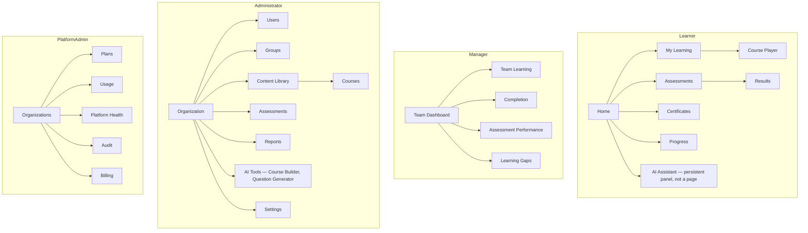

# Design System Architecture

Defined before CMS/UI implementation, per the brief. This is IA, navigation, component, and token architecture — not visual branding. **No brand colors, logo, or product name are fixed here** — the product name and domain are not yet decided (see project memory `project-lms-naming-tbd`); all tokens are semantic, not literal brand values, so branding can be dropped in later without a rework.

## 1. Four personas, four experiences, one system

| Persona | Primary job | Top-level nav |
|---|---|---|
| **Learner** | Consume content, get assessed, track progress | Home · My Learning · Assessments · Certificates · Progress · AI Assistant |
| **Manager** | See and improve their team's learning outcomes | Team Dashboard · Team Learning · Completion · Assessment Performance · Learning Gaps |
| **Administrator** | Run the org's content, people, and settings | Organization · Users · Groups · Content · Courses · Assessments · Reports · AI Tools · Settings |
| **Platform Administrator** | Operate the multi-tenant platform itself | Organizations · Plans · Usage · Platform Health · Audit · Billing |

Each persona gets a distinct top-level navigation and information architecture (below), but they share one component library, one token set, and one interaction language — a Manager who is also enrolled as a Learner in a course switches *context*, not *products*.

## 2. Information architecture per persona

The **AI Assistant is a persistent, dockable panel available from every Learner screen**, not a separate destination page — matching its role as a study companion, not a standalone tool.

## 3. Navigation model

- **Learner / Manager:** left rail (desktop) / bottom tab bar (mobile-width), max 5–6 top-level items, matching the IA above — flat, not deeply nested, since these personas need speed over completeness.
- **Administrator / Platform Administrator:** left rail with grouped sections and a breadcrumb trail for drill-down (e.g. Organization → Users → \[user detail\]) — these personas tolerate more depth in exchange for power.
- **Role-based routing, not role-based rendering of a single layout:** a Manager who is also a Learner in some course accesses `/learn/*` routes under the Learner IA; there is no single "everything for everyone" dashboard trying to serve all four personas from one shell.

## 4. Component inventory (built on Tailwind CSS + Radix UI primitives, per [ARCHITECTURE.md](ARCHITECTURE.md)/tech stack decision)

| Category | Components |
|---|---|
| Layout | App shell (rail + content), page header, card, section, empty state |
| Navigation | Rail nav item, tab bar, breadcrumb, tabs |
| Data display | Table (sortable/paginated), stat tile, progress bar/ring, badge/status chip, avatar, timeline |
| Forms | Text/number/select/date inputs, rich text editor (content authoring), file uploader (content assets), search/filter bar |
| Feedback | Toast, inline banner, modal/dialog, confirmation dialog (destructive actions), skeleton loader |
| Learning-specific | Course player shell, lesson stepper, knowledge-check inline card, question renderer (per `question_bank.type`), certificate card, AI chat bubble/panel, grounded/generated/unsupported answer badge (see [AI_ARCHITECTURE.md](AI_ARCHITECTURE.md) §5) |

All built on Radix primitives for accessible behavior (focus trapping, keyboard nav, ARIA roles) with Tailwind for styling — the same foundation an earlier project already uses successfully (see tech stack decision), reused as a pattern, built fresh in the new repo.

## 5. Design tokens (semantic, not brand-literal)

| Token category | Examples | Note |
|---|---|---|
| Color roles | `--color-bg`, `--color-surface`, `--color-ink`, `--color-accent`, `--color-success`, `--color-warning`, `--color-danger` | Values TBD with branding; roles fixed now so components never hardcode a hex |
| Typography scale | `--text-xs` … `--text-3xl`, defined ratio (e.g. 1.25 modular scale) | Typeface TBD with branding |
| Spacing scale | `--space-1` (4px) … `--space-12` (96px) | Consistent 4px base unit |
| Radius | `--radius-sm/md/lg/full` | |
| Elevation | `--shadow-sm/md/lg` | Used sparingly — flat-first UI |
| Motion | `--duration-fast/base/slow`, respects `prefers-reduced-motion` | |

## 6. Responsive behavior

- Breakpoints: `sm 640px · md 768px · lg 1024px · xl 1280px`, mobile-first.
- Learner/Manager IA collapses to a bottom tab bar below `md`; Administrator/Platform Administrator IA collapses the rail to an overlay drawer below `lg` (power-user surfaces are usable but not optimized for phones in v1 — desktop/tablet is primary for those two personas).
- The course player and AI Assistant panel are explicitly designed mobile-first, since Learner usage skews toward mobile/tablet.

## 7. Accessibility requirements (WCAG 2.1 AA baseline, non-negotiable for MVP)

- Full keyboard operability for every interactive component, including the course player and quiz/assessment flow.
- Visible focus states on every focusable element (no `outline: none` without a replacement).
- Color is never the only signal for state (status chips pair color with text/icon).
- All form inputs have associated labels; all images/media have alt text or transcripts (transcripts also feed AI retrieval — see [CONTENT_MODEL.md](CONTENT_MODEL.md)).
- `prefers-reduced-motion` respected across all transitions.
- Minimum 4.5:1 contrast for text, 3:1 for large text/UI components — enforced by the token palette once branding lands, checked automatically in CI (see [TESTING.md](TESTING.md) §4 "critical UI tests").
