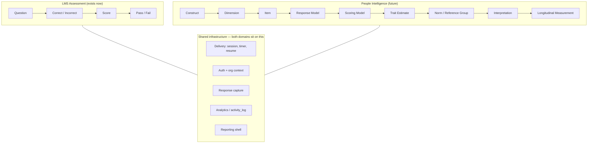
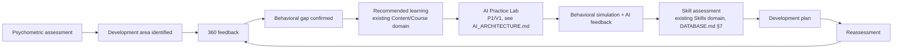

# People Intelligence Engine (Future Domain — Architecture Reserved)

**Status: FUTURE / ARCHITECTURE RESERVED. Priority: P2/P3. Not in MVP, not in Phase 1–4.**

This document exists to prove — and record the reasoning for — one claim: *the platform-core and LMS-assessment architecture being built now does not block this domain later.* Nothing described here is implemented. No instruments, items, norms, or validity claims are created by this document or by this platform at this stage; real psychometric instruments require qualified psychometricians/I-O psychologists, not generated content.

## 1. What this domain eventually is

Four capabilities, evolving the platform from an LMS into an AI-native Learning & **Capability** Platform:

1. **Psychometric Assessments** — scientifically validated instruments (personality, aptitude, etc.), hosted, not authored, by this platform.
2. **360° Feedback** — multi-rater competency-based feedback campaigns.
3. **Situational Judgement Testing (SJT)** — scenario-based judgment assessment with non-binary scoring.
4. **Behavioral / Cognitive Assessments** — reasoning, learning agility, and capability-tendency instruments (a specialization of #1's instrument model, not a fifth architecture).

## 2. The one rule that makes this work: separate scoring, shared plumbing

**The LMS Assessment Engine (`assessments`, `question_bank`, `assessment_attempts`, `attempt_answers` — see [DATABASE.md](DATABASE.md) §4) is never extended to carry constructs, norms, or trait estimates.** It stays exactly as scoped: correct/incorrect → score → pass/fail. People Intelligence gets its **own, parallel entity families** (§4 below) that follow the same platform *conventions* (org-scoped, RLS-protected, versioned, audited) but are not foreign-keyed into `question_bank` or `assessment_attempts`. This is the concrete mechanism behind the "yes, without redesign" answer in §6.

What genuinely is shared, because it's already domain-agnostic in the platform core:

- **Delivery mechanics** — session start/resume, timing, progress — the Design System's course-player/assessment-delivery shell ([DESIGN_SYSTEM.md](DESIGN_SYSTEM.md) §4) is already decoupled from scoring logic.
- **Auth, org context, RBAC** — [MULTI_TENANCY.md](MULTI_TENANCY.md) conventions apply unchanged.
- **Response capture shape** — a session containing timestamped, ordered responses is a generic pattern both domains use, even though what a "response" *means* differs completely.
- **Analytics/audit** — `activity_log`, `ai_usage_log` capture People Intelligence events the same way they capture LMS events, via the existing generic discriminator columns — no schema change required to start logging a new `event_type` or `feature` value.
- **Skills evidence** — the Skills domain's `source_type`/`source_id` pattern ([DATABASE.md](DATABASE.md) §7) already accepts new evidence sources without modification (§5 below).

## 3. Cross-sub-domain shared primitives (within People Intelligence, not with the LMS)

Two configuration entities are reused *across* Psychometrics, 360, and SJT, since they're genuinely the same concept in each:

- **`response_scales`** — defines a reusable rating scale (Likert-5, Likert-7, frequency, yes/no, forced-choice). A psychometric item and a 360 questionnaire item can reference the same scale definition.
- **`scoring_models`** — defines a reusable scoring strategy (CTT sum, CTT mean, 1PL/2PL/3PL IRT, Rasch, keyed-response, partial-credit, competency-weighted). A psychometric instrument and an SJT scenario set can each reference a scoring model appropriate to them, without the concept being defined twice.

## 4. Conceptual entities (names and purpose only — no column-level schema yet)

Per the brief, these are **architectural placeholders**, not implemented tables. Each would follow the standard tenant-table pattern from [DATABASE.md](DATABASE.md) §1 (`id`, `org_id`, `created_at`, `updated_at`, `created_by`, plus `status`/`version` where content-like) when actually built.

**Psychometrics**

| Entity | Purpose |
|---|---|
| `psychometric_instruments` | An instrument definition (e.g. a named personality or aptitude measure) |
| `psychometric_instrument_versions` | Versioned revisions; carries `reliability_metadata jsonb`, `validity_evidence jsonb`, `calibration_data jsonb` — psychometrician-supplied, never platform-generated |
| `constructs` | What the instrument measures at the top level |
| `dimensions` | Sub-divisions of a construct |
| `facets` | Sub-divisions of a dimension |
| `psychometric_items` / `psychometric_item_versions` | The item bank, versioned; carries `reverse_scored boolean`, `weight numeric` |
| `response_scales` | Shared with §3 |
| `scoring_models` | Shared with §3; for IRT-based models, references calibration parameters (difficulty/discrimination/guessing — 1PL/2PL/3PL) held on the item version |
| `norm_groups` | Reference populations for standard scores / percentiles |
| `psychometric_results` | Trait estimates, standard scores, percentiles for a person, per instrument version, per administration — the longitudinal record (repeated results over time, not overwritten) |

**360° Feedback**

| Entity | Purpose |
|---|---|
| `competency_frameworks` / `competencies` / `behavioral_indicators` | Org-configurable competency model (§5 in the brief — never hardcoded) |
| `feedback_campaigns` | A configured 360 cycle: subject(s), framework, questionnaire, dates, reminders, anonymity rules |
| `feedback_participants` | The subject(s) of a campaign |
| `feedback_raters` / `rater_groups` | Who rates whom, grouped (`self`/`manager`/`peer`/`direct_report`/`external`/custom) |
| `feedback_questionnaires` / `feedback_items` | The instrument being administered, mapped to competencies/indicators |
| `feedback_responses` | Raw, rater-attributed responses — **never exposed directly**, see §5 |
| `feedback_results` | Aggregated, anonymity-rule-enforced scores per competency/dimension, per rater group, per cycle |
| `development_plans` | Links a person, an identified gap (from `feedback_results`, `psychometric_results`, or Skills), recommended learning (FK into the existing Content/Course domain), and a reassessment target — the integration-loop entity, §7 |

**Situational Judgement Testing**

| Entity | Purpose |
|---|---|
| `scenarios` | The situational prompt |
| `scenario_options` | Response options — **no assumption of one correct answer** |
| `scenario_competencies` | Maps options/scenarios to competencies being assessed |
| `scenario_scoring_models` | References `scoring_models` (§3) configured for keyed/partial-credit/expert-derived/competency-weighted scoring |

**Behavioral / Cognitive Assessments** are not a fifth entity family — they are `psychometric_instruments` with `construct` types like numerical/verbal/logical/abstract reasoning, data interpretation, attention, learning agility, or role-capability tendencies (leadership/managerial/sales). No separate schema needed; this is intentional, not an oversight.

## 5. Anonymity as an architectural requirement, not a UI rule

The brief is explicit: hiding a name in the UI is not sufficient. The enforcement lives at the **aggregation/query layer**, not the presentation layer:

- `feedback_responses` (raw, rater-attributed) is **never** directly queryable by an org admin or manager through any reporting route — only through a dedicated aggregation function.
- A `feedback_results` row is only computed (and only becomes visible) for a rater group once that group meets its configured **minimum response threshold** (e.g. "aggregate peer feedback only once ≥3 peers have responded"). Below threshold, the platform returns *no data for that group*, not a smaller, more identifying sample.
- This requires a genuinely new pattern beyond what [MULTI_TENANCY.md](MULTI_TENANCY.md) defines today: **threshold-gated aggregate visibility**, layered on top of (not replacing) standard org-scoped RLS. It is additive infrastructure, built when Phase 5 (360° Feedback) starts — it does not require revisiting the RLS helper functions or policy shape already defined for Phases 1–4.
- `self` and `manager` rater groups may be individually identifiable per the brief's example; this is a per-rater-group configuration on `rater_groups`, not a global switch — enforced the same way (the aggregation function checks the group's identifiability flag before deciding whether to return individual vs. threshold-gated aggregate rows).

## 6. The two architectural tests, answered

**"Can the proposed generic assessment architecture later support a psychometric instrument with a non-binary scoring model, multiple constructs, norm-referenced scores, repeated measurement, and an independent interpretation layer without redesigning the core LMS assessment engine?"**

**Yes.** Because the LMS assessment engine is never touched — Psychometrics gets its own entity family (§4) that reuses only cross-cutting platform conventions (org-scoping, RLS pattern, delivery shell, activity/AI logging), never the LMS's `question_bank`/`assessment_attempts` tables. The one piece of net-new infrastructure this requires — an `adaptive` delivery strategy for future CAT, alongside today's `fixed`/`randomized` — is an additive value on the session/delivery concept, not a restructuring of it (see §2's shared-plumbing list). Repeated measurement is native to `psychometric_results` being an append-only, timestamped table rather than a single mutable score per person.

**"Can the proposed architecture support a 360 campaign with multiple rater groups, anonymous aggregation, repeated cycles and competency-based reporting without redesigning the LMS?"**

**Yes**, with one explicit caveat: it requires the threshold-gated aggregation mechanism described in §5, which does not exist yet. That mechanism is **new**, but it is **additive** — it sits beside the existing RLS/reporting patterns and is scoped entirely to `feedback_*` tables. It does not require changing `organizations`, `profiles`, `courses`, `assessments`, or any RLS policy already written for Phase 1–4. Repeated cycles are native to `feedback_campaigns` being a repeatable, dated entity rather than a singleton per org.

## 7. The development loop (why this domain exists at all)

Every node after "Recommended learning" already has a place to attach evidence in the schema defined in Phases 1–4 (`progress`, `ai_usage_log` with `feature = 'practice_lab'`, and the Skills domain's generic `source_type`/`source_id` evidence pattern). People Intelligence adds new *evidence sources* into that existing pattern; it does not require the Skills domain to be redesigned when it arrives (Phase 6–8).

## 8. AI's role and limits in this domain

AI may assist with: interpretation narrative drafting, personalized development recommendations, report narrative generation, question/scenario **drafting** (never auto-published), scenario generation for SJT, qualitative-comment summarization for 360 open-text responses, and AI coaching tied to AI Practice Lab.

AI must **never**: compute a trait estimate, standard score, or percentile itself (scoring is deterministic, auditable code operating on `scoring_models`/`norm_groups` — never an LLM call); assert or imply an instrument is scientifically valid or reliable (reliability/validity metadata comes only from documented, psychometrician-supplied evidence on `psychometric_instrument_versions`, never generated); or publish generated psychometric/360 content without mandatory human expert review — extending the same grounded/generated/unsupported discipline already defined in [AI_ARCHITECTURE.md](AI_ARCHITECTURE.md) §5, specialized here as: **the number is always deterministic; only the narrative around the number is ever AI-assisted, and even that is reviewed.**

## 9. Explicit non-goals of this document

This document does not create, and this platform does not currently contain: any psychometric instrument, item, personality construct, norm table, reliability coefficient, validity claim, IRT/CAT engine, or 360 engine. It exists solely so that Phase 1's schema and RLS design do not have to be revisited when Phases 5–8 begin.
