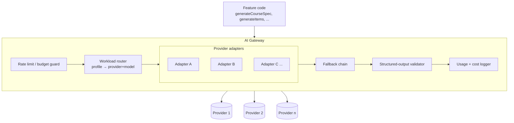

# Phase 3 — AI Architecture

**Deliverable F.** The model-agnostic AI layer. Extends [AI_ARCHITECTURE.md](AI_ARCHITECTURE.md) (which specified the Phase 4 Tutor/RAG design) with the gateway and generation pipeline Phase 3 needs.

## 1. Non-negotiables

1. **Model-agnostic.** No provider or model name is hard-coded into feature code. Nothing about the platform assumes Claude, or any other vendor. Swapping or adding a provider is configuration plus an adapter — never a change to a feature.
2. **The LLM produces a validated structured course specification — never application code.** No generated JavaScript, HTML, SQL, or executable content of any kind reaches the platform or a learner.
3. **Every call is logged** to `ai_usage_log` on both success and failure branches — the rule already set in [AI_ARCHITECTURE.md](AI_ARCHITECTURE.md) §1, inherited without exception.
4. **AI drafts; humans approve.** Generated content enters at `status = draft` and moves only through the existing workflow.
5. **Tenant isolation is structural.** Any retrieval is org-filtered inside the query, never post-filtered.

## 2. Gateway architecture



**Feature code never names a model.** It names a **workload profile**:

```
generateStructured({ profile: "course_outline", schema, input })
```

The gateway resolves `course_outline` → a provider/model chain from configuration.

## 3. Workload profiles

Different jobs have genuinely different cost/quality/latency needs. Profiles make that explicit and tunable without code changes.

| Profile | Characteristics | Typical use |
|---|---|---|
| `course_outline` | High reasoning, low volume, latency-tolerant | Source → structure, objectives |
| `content_expansion` | Medium reasoning, high volume | Page/block prose |
| `item_generation` | High precision, structured | Quiz and knowledge-check items |
| `rewrite_localize` | Low reasoning, high volume, cheap | Tone/reading-level/locale variants |
| `classification` | Cheapest available | Skill tagging, block-type suggestion |
| `chat_stream` | Streaming-capable | Reserved for the Phase 4 Tutor |

Configuration (per profile): ordered provider/model chain, temperature and token ceilings, timeout, retry policy, cost ceiling. Stored as platform configuration with **per-org override capability** reserved — an enterprise tenant may later require a specific provider for data-residency reasons, and the design should not have to change for that.

## 4. Structured output — the contract

The gateway's `generateStructured` is the only generation primitive Phase 3 features use.

```
generateStructured({ profile, schema, input, context }) → { data, meta }
```

**Pipeline:**

1. **Prompt assembly** — system instruction, the target JSON Schema, and the source content, with a hard separation between instruction and untrusted source (see §7).
2. **Provider call** — using native structured-output/tool-calling where the provider supports it, falling back to schema-in-prompt plus extraction where it does not. This difference is the adapter's problem, never the feature's.
3. **Parse and validate** against the JSON Schema.
4. **Repair loop** — on validation failure, up to *N* bounded retries, feeding the validator's errors back. Never silently "fix" output in code, and never accept partially-valid output.
5. **Reject** after the retry budget — the job fails with the validation findings surfaced to the author. A failed generation is an honest outcome; a silently-degraded course is not.
6. **Log** provider, model, tokens, latency, cost, success/failure, retry count.

**Why a repair loop and not code-side coercion:** coercion hides model weakness and produces content that passes validation but is semantically wrong. A bounded repair loop either gets valid output or reports failure, which is the behaviour an author can trust.

## 5. Generation pipeline (source → spec)

Multi-step, mirroring the [AI_ARCHITECTURE.md](AI_ARCHITECTURE.md) §3 principle that isolated steps are reviewable and recoverable where one giant generation is not.

```mermaid
flowchart LR
  IN[Prompt / PDF / DOCX / PPT / URL] --> EX[Extract text<br/>unpdf · mammoth · fetch]
  EX --> CH[Chunk + summarise<br/>if over context budget]
  CH --> OUT[1. Outline<br/>sections + pages]
  OUT --> OBJ[2. Learning objectives]
  OBJ --> BLK[3. Blocks per page]
  BLK --> INT[4. Interactions / scenarios<br/>where appropriate]
  INT --> ITM[5. Knowledge-check items]
  ITM --> SKL[6. Skill tagging]
  SKL --> A11Y[7. Accessibility fill<br/>alt text, captions hints]
  A11Y --> ASM[Assemble full spec]
  ASM --> V[Validate whole spec]
  V --> DRAFT[(course_specifications<br/>status = draft)]
```



Each numbered step is a separate `generateStructured` call with its own narrow schema, recorded in `authoring_jobs.steps`. Consequences:

- A failure at step 5 does not discard steps 1–4.
- An author can regenerate one step (`/regenerate` with a scope) without touching the rest.
- Each step can use a **different profile** — outline needs reasoning, expansion needs volume, tagging needs cheapness.
- Cost is attributable per step, not per opaque "course generation".

**Document extraction is already proven** on Cloudflare Workers (`unpdf`, `mammoth`) — the highest-risk item of the original validation spike. PPT and URL extraction are new and should be validated early.

## 6. Model-agnosticism in practice

What the design must survive without a rewrite:

| Change | Impact |
|---|---|
| Add a new provider | New adapter + config entry. No feature code changes. |
| Swap the model for one profile | Config change only. |
| A provider's structured-output API differs | Absorbed in the adapter. |
| A provider is down | Fallback chain moves to the next entry; logged. |
| An org demands a specific provider (residency) | Per-org profile override — reserved in the config shape from day one. |
| Self-hosted / on-prem model | Another adapter behind the same interface. |

**Anti-pattern explicitly avoided:** provider-specific prompt hacks leaking into feature code. Prompts are versioned assets owned by the gateway layer and selected per profile, so a provider-specific system-prompt tweak lives with the adapter, not in the course-generation feature.

## 7. AI safety in the authoring context

[AI_ARCHITECTURE.md](AI_ARCHITECTURE.md) §5 defined grounded/generated/unsupported labelling for the Tutor. Authoring needs different controls, because the risk is different — the threat is not a wrong answer to a learner, it is **untrusted source material steering generation**, and **generated content reaching learners unreviewed**.

| Risk | Control |
|---|---|
| **Prompt injection via uploaded document** ("ignore previous instructions…") | Source text is passed as clearly-delimited *data*, never concatenated into the instruction. Output must still satisfy the schema — an injected instruction cannot produce a valid spec that does something else, because the spec has no field that expresses "do something else". |
| **Generated executable content** | Structurally impossible: the block schema has no code field, triggers are a closed declarative set, and rich text is sanitised on write and render. |
| **Hallucinated factual content** | Provenance: each generated block records the source chunk it derived from, surfaced in the review UI so a reviewer can check a claim against its source in one click. |
| **Unreviewed publication** | Generated specs enter at `draft`; the Phase 2 state machine is the only path to `published`, and it requires explicit human transitions. |
| **Cost abuse / runaway jobs** | Per-org concurrency caps, token/cost budgets, and a bounded repair-retry budget, all enforced at the gateway. |
| **Cross-tenant leakage via generation** | Generation context is assembled only from the requesting org's assets; there is no shared corpus in Phase 3. |
| **Silent quality degradation on provider change** | Golden-set regression: a fixture corpus generated and schema-checked whenever a profile's provider/model changes. |

## 8. Cost and observability

Every call logs to `ai_usage_log` (`org_id`, `user_id`, `feature`, `provider`, `model`, `tokens_in`, `tokens_out`, `latency_ms`, `success`, `error_message`, `cost_usd`). Phase 3 additionally needs, for a multi-step pipeline to be operable:

- `job_id` correlation so a course's total generation cost is answerable
- Per-step attribution inside `authoring_jobs.steps`
- Org-level budget state with a documented behaviour on exhaustion — **fail clearly, never silently downgrade to a cheaper model**, which would make quality mysteriously vary

## 9. What Phase 3 does NOT build

| Not built | Why | When |
|---|---|---|
| RAG / `ai_knowledge_chunks` / pgvector | Retrieval belongs with the Tutor and needs published content at volume | Phase 4 |
| AI Tutor / streaming chat | Depends on RAG | Phase 4 |
| AI Practice Lab | Depends on scenario content and the Tutor's conversational primitives | Phase 7 |
| Fine-tuning / custom models | No evidence yet that prompt+schema is insufficient | Not scheduled |
| AI-computed scores of any kind | Scoring is deterministic code — the rule set in [PEOPLE_INTELLIGENCE.md](PEOPLE_INTELLIGENCE.md) §8, applied here too | Never |

The `streamChatResponse` primitive from [AI_ARCHITECTURE.md](AI_ARCHITECTURE.md) §1 is **specified in the gateway interface in Phase 3 but not consumed**, so Phase 4 adds a feature rather than reopening the gateway.
