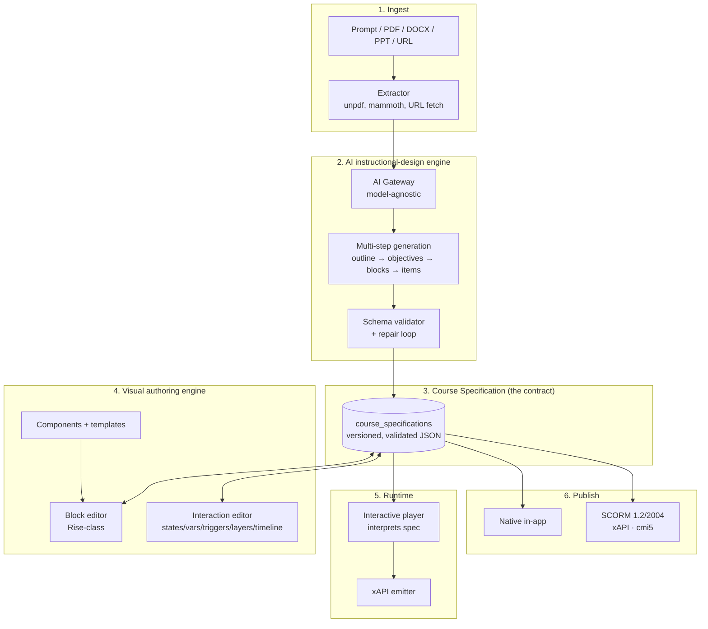

# Phase 3 — Technical Architecture

**Deliverable C.** How the AI-Native Authoring Engine is built, and — critically — **whether the existing Phase 1/2 architecture can carry it without major rewrites.** No implementation.

## 1. System shape



## 2. The Course Specification

A versioned, schema-validated JSON document. It is the only thing the AI writes, the only thing the editor edits, and the only input the renderer and publishers consume.

**Structure (conceptual, not final field names):**

```
CourseSpec
├─ meta            title, description, locale, version, accessibility profile
├─ skills[]        skill tags (Phase 3 annotates; Phase 6 computes proficiency)
├─ variables[]     name, type (number|text|boolean), scope, initial value
├─ theme           tokens: colour, type scale, spacing (org-themeable)
├─ sections[]      ≈ modules
│   └─ pages[]     ≈ lessons — the addressable navigation unit
│        └─ blocks[]
│             ├─ type        text | image | video | audio | embed | list | quote
│             │              | accordion | tabs | flashcards | scenario | quiz
│             │              | knowledgeCheck | interaction | component
│             ├─ content     type-specific payload
│             ├─ a11y        altText, caption track ref, reading-order hint
│             ├─ states[]    named visual/behavioural states
│             ├─ layers[]    overlay content with its own blocks
│             ├─ timeline    optional cue points for timed reveal
│             └─ triggers[]  when <event> on <target> if <condition> do <action>
└─ assessment      inline items (Phase 3) / question-bank refs (Phase 4)
```

**Design rules that keep this from rotting:**

- **Additive, versioned schema.** `spec_schema_version` is stored on every row. Renderers must handle every version they claim to support; migrations are explicit, never implicit re-interpretation.
- **No executable content.** Triggers are declarative (`{when, target, condition, action}`), evaluated by our runtime. There is no `eval`, no author-supplied JavaScript, no arbitrary HTML injection in Phase 3. This is a security boundary, not a limitation to be quietly relaxed later.
- **Blocks are closed-set.** Adding a block type is a schema change with a matching renderer — not an open extension point that the AI can invent into.
- **Components are references, not copies.** A `component` block points at a `component_definitions` row, so updating a component updates every course that uses it, exactly as learning-object reuse works today.

## 3. Rendering architecture

One spec, three consumers — sharing a single interpreter so behaviour cannot diverge:

| Consumer | How |
|---|---|
| **Authoring preview** | The player component in edit mode, rendering the in-memory spec |
| **In-app runtime** | The player component in play mode, hydrating from the published snapshot |
| **Exported package** | The same interpreter bundled into a self-contained package with the spec inlined |

The interpreter is a **pure function of (spec, runtime state)**. Runtime state (variable values, visited pages, states) lives in a small state machine; triggers are evaluated against it. This is what makes the exported SCORM/cmi5 package behave identically to the in-app player: same interpreter, different host adapter.

**Host adapters** isolate everything environment-specific:

- `NativeAdapter` — talks to our progress/xAPI APIs
- `ScormAdapter` — talks to the SCORM API (`LMSSetValue`, `LMSCommit`) via `scorm-again`
- `Cmi5Adapter` / `XapiAdapter` — posts statements to the configured LRS endpoint
- `AiccAdapter` — HACP form posts

## 4. Does the existing Phase 1/2 architecture support this?

**Assessed honestly, per requirement 5. Short answer: yes, additively — with four things that need real design work and one that needs a decision.**

### 4.1 What carries over unchanged

| Existing | Verdict |
|---|---|
| Multi-tenancy, `org_id` + four-policy RLS | **Unchanged.** Every new entity follows the same pattern. No policy rewrite. |
| `withAuth()` + role hierarchy | **Unchanged.** New routes opt in identically. |
| Draft→Review→Approval→Published→Archived state machine (`lib/content/publish.ts`) | **Unchanged and reused.** Authored content moves through the same workflow. |
| `content_versions` (polymorphic snapshots) | **Extends by adding an `entity_type`** (`course_specification`). No structural change — this is exactly why it was made polymorphic. |
| `content_reviews` | Same — new `content_type` value. |
| Enrolment + version pinning | **Unchanged.** Already pins `enrolled_version`; authored courses inherit the guarantee. |
| `content_assets` + private bucket + signed URLs | **Unchanged.** Blocks reference assets by id. |
| SCORM ingest (`scorm_packages`) | **Unchanged.** Ingest and export are separate concerns. |
| `activity_log`, `ai_usage_log` | **Unchanged.** Generic discriminators already accept new event/feature values. |

### 4.2 What is genuinely new (additive, not a rewrite)

1. **Course specification storage** — a new entity family (§ [PHASE3_DATA_MODEL.md](PHASE3_DATA_MODEL.md)). Additive.
2. **Component/template library** — new entities, same tenancy pattern. Additive.
3. **AI gateway** — new subsystem, no existing code to change. Additive.
4. **Publishing pipeline + package storage** — new bucket, new job path. Additive.
5. **xAPI statement emission** — new table + endpoint. Additive.

### 4.3 The four areas needing real design work

These are where "additive" stops being automatic and genuine thought is required:

**(a) Progress granularity.** Today `progress` is one row per `(user, learning_object)`. An interactive course needs finer state: which page, which variable values, which blocks completed, resume position. Extending `progress` with a JSONB blob would work but conflates two concerns. **Recommendation:** a separate `course_runtime_state` table for resumable interaction state, leaving `progress` as the completion ledger it already is. This keeps Phase 2's derived-completion logic intact.

**(b) Where authored content attaches to the existing model.** A course specification could either *replace* the `modules/lessons/lesson_learning_objects` tree or *sit inside* a learning object. **Recommendation:** a learning object gains a `source` discriminator — `assets` (today's behaviour), `authored` (points at a course specification), or `scorm`. This preserves the learning object as the reuse unit (the entire premise of the Phase 2 content model) and means authored content is reusable across courses for free, with no change to `lesson_learning_objects`.

**(c) Publish-time snapshot size.** Phase 2 snapshots are small JSON. A full authored course spec with many blocks could be large. **Recommendation:** keep the snapshot in `content_versions` if it stays modest, but design the column contract so the snapshot may be a *pointer to an immutable object in Storage* when it exceeds a threshold. Decide the threshold with real data during Phase 3, not now.

**(d) Long-running AI generation.** A multi-step generation over a large PDF will exceed a normal request lifetime. Cloudflare Workers have CPU-time limits. **Recommendation:** model generation as a **job** (`authoring_jobs`) with status polling or streaming progress, not a single synchronous request. This also gives retry, partial-failure recovery, and an audit trail for free.

### 4.4 The one decision that must be made before building

> **Resolved 2026-08-16 — Cloudflare Workflows.** Proven on the real engine, not just locally: 14/14 claims, including a 244-second run across two hibernations, per-step retry with no re-execution of completed steps, and cancellation. Because `@opennextjs/cloudflare` owns its generated worker entrypoint, the workflow classes live in a **separate `jobs` worker**, bound to the Next.js worker via a `workflows` binding with `script_name` — a topology that was itself verified. Full verdict: [JOB_EXECUTION_SPIKE_RESULTS.md](JOB_EXECUTION_SPIKE_RESULTS.md). The options table below is retained as the record of what was weighed.

**Where the generation job actually runs.** Options:

| Option | Pros | Cons |
|---|---|---|
| Cloudflare Workers + Durable Objects / Queues | Same platform, no new infra | CPU limits; needs Workers paid tier; new primitives to learn |
| Cloudflare Workflows | Built for durable multi-step execution | Newer; adds a platform dependency |
| Supabase Edge Functions | Close to the data | Second runtime to operate |
| External worker (container/VM) | No limits | New infrastructure, new ops burden — against the current grain |

**Recommendation:** validate Cloudflare Queues or Workflows in a spike at the *start* of Phase 3, exactly as the SCORM spike de-risked Phase 2. This is the single highest-risk unknown in the phase and should not be discovered late.

### 4.5 What would constitute a rewrite (and is therefore avoided)

For completeness — these are the designs explicitly **rejected** because they would break Phase 2:

- Replacing `modules`/`lessons` with the spec tree (would orphan enrolment, progress, and the reuse join).
- Storing authored content as generated HTML (would break versioning diffs, accessibility validation, and multi-target publishing).
- Letting the AI write into content tables directly (would bypass the workflow state machine and the review gate).
- Extending `assessments`/`question_bank` to carry interaction state (the same mistake [PEOPLE_INTELLIGENCE.md](PEOPLE_INTELLIGENCE.md) §2 warns about for psychometrics).

## 5. Security and RLS implications

| Concern | Approach |
|---|---|
| New entities | `org_id NOT NULL` + four-policy RLS in the creating migration. No exceptions — the Phase 1 rule. |
| Authored content is user-supplied data | Declarative triggers only; no author JS; no raw HTML injection. Rich text is sanitised to an allowlist on write **and** on render. |
| Published packages contain our interpreter | Packages are built server-side from the spec; a client never assembles a package. |
| Package storage | Separate bucket, `org_id/...` prefixed, private, signed-URL download — same discipline as `content-assets`. |
| xAPI statements | `org_id NOT NULL`; actor is the platform user; endpoints authenticated. Statements are append-only. |
| AI prompt injection via source documents | Extracted source text is treated as **untrusted data**, never as instructions. The generation prompt separates system instruction from source content, and the output is schema-validated — a document cannot make the model emit an invalid spec, and an invalid spec is rejected rather than repaired blindly. |
| AI cost abuse | Per-org rate limits and budget caps enforced at the gateway, with `ai_usage_log` as the audit trail. |
| Cross-tenant component/template reuse | Components are org-scoped. Any future platform-level template library is an explicit, separately-modelled concept — never a nullable `org_id` on the org-scoped table. |

## 6. Performance considerations

- **Spec size.** Large courses produce large JSON. The editor should load a course spec lazily per section where practical, and the runtime should hydrate progressively.
- **Autosave.** Editing must not require a full-document write per keystroke; batch and debounce, with optimistic UI.
- **Publishing.** Package building is a job, not a request.
- **Search.** Authored block text should be indexed for the existing full-text search — an additive `tsvector` over extracted spec text, following the Phase 2 pattern.

## 7. Testing strategy (inherited discipline)

Same bar Phase 2 met, extended:

- Data-layer tenant-isolation tests for every new table, added in the same step as the table.
- API-layer role-matrix and isolation tests for every new route.
- **Spec validation tests** — malformed specs must be rejected with useful errors, not silently accepted.
- **Interpreter conformance tests** — a fixture spec exercising every block type, trigger, state, variable, and layer, asserted against expected runtime behaviour.
- **Export conformance** — a published SCORM package validated against a third-party conformance checker, and an xAPI/cmi5 package's statements validated against the specification.
- **Accessibility tests** — automated axe-class checks on rendered output, plus keyboard-only traversal in Playwright.
